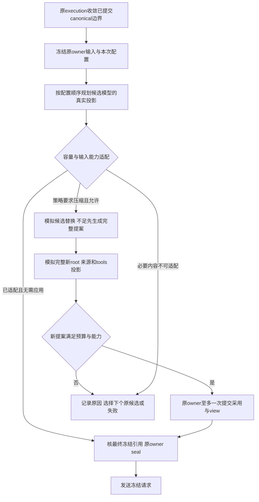
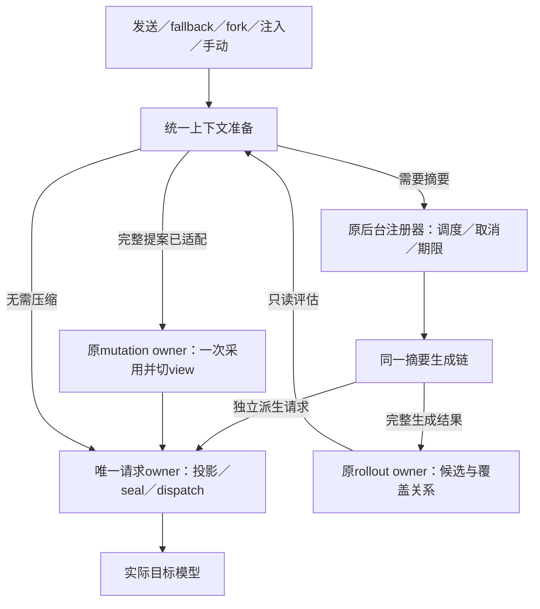
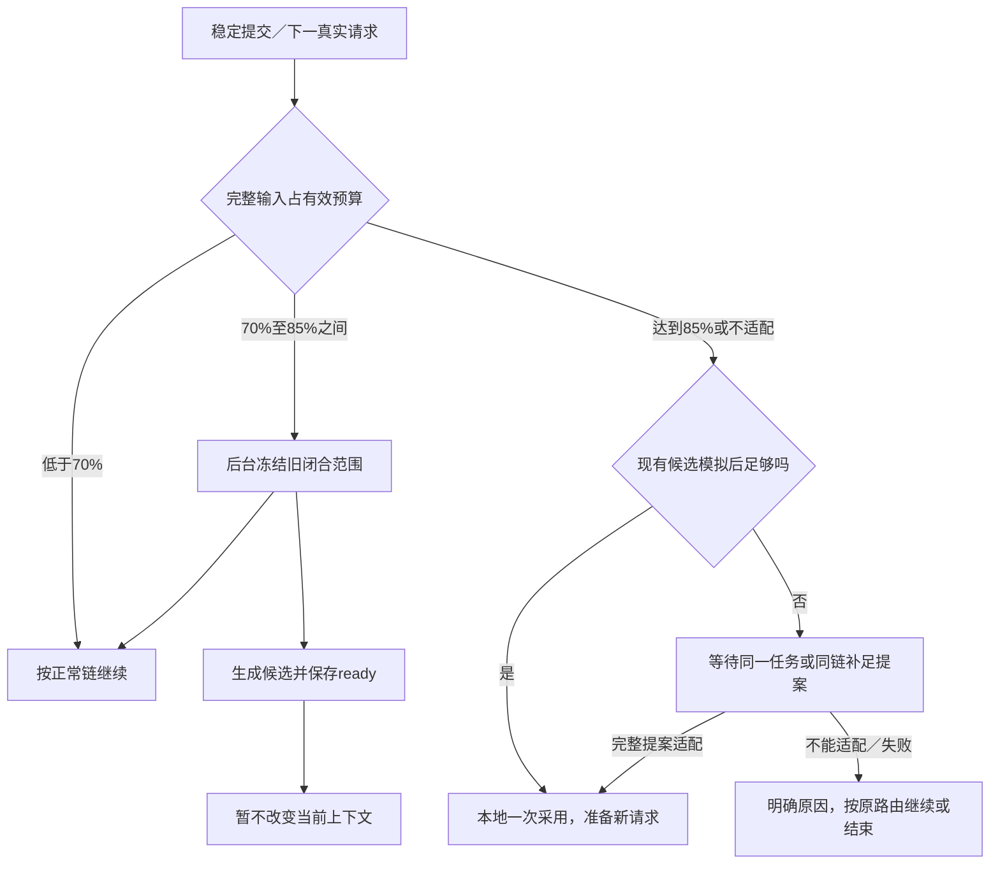
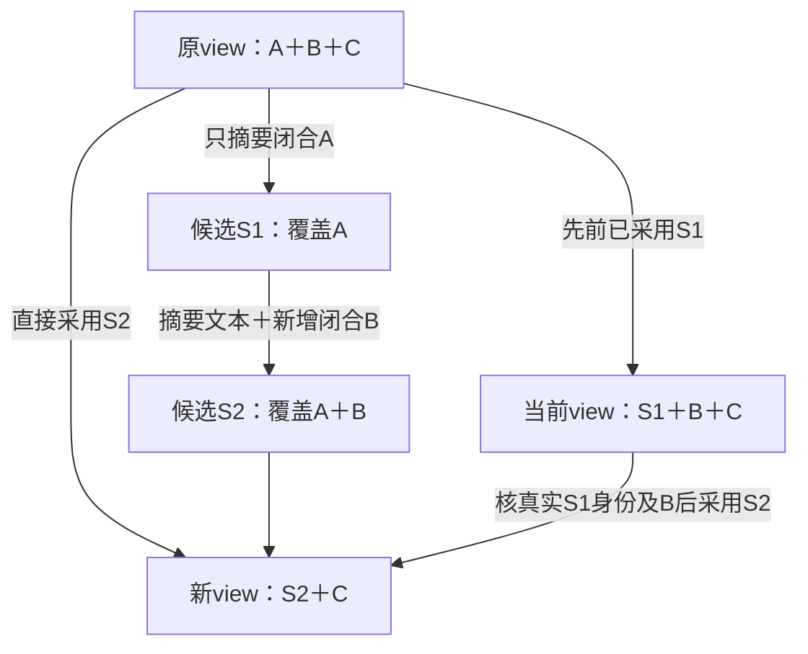
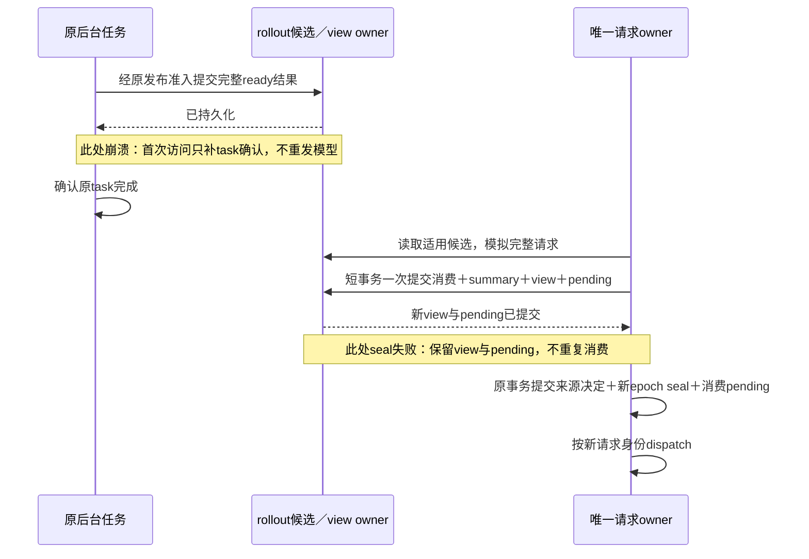

## Context

动机见 proposal。现有 `app/agents/summarization` 在 wrap model call 中同步判断和生成摘要，`factory.py` 已改为读取冻结 Workspace 压缩策略，并在未知输入容量时关闭自动触发；实际候选路由仍在后续 middleware 才发生，尚未接到最终请求预算。现行缩减检查只要求 after < before，并不证明结果适合下一目标。`retry.py` 的 suffix-only 重试会少读来源，却仍可能替换原完整范围。

已有可复用边界：

| 事实／操作 | 现有 owner／入口 | 本次职责 |
|---|---|---|
| Provider／Model 选择与能力匹配 | `model_capability_routing.py`、配置目录／resolver | 输出本次实际模型及元数据快照；fallback 每次重新准备 |
| 真正模型请求 | `agent_factory.py` → `model_call_graph.py::create_model_call_agent` → `ModelCallExecution.execute/aexecute` | Graph适配与typed派生输入汇合后，唯一 prepare → seal → dispatch；复用原adapter、日志及model-call登记 |
| 无Turn准入及冷恢复 | `domain/itemized/execution_admission.py`、checkpoint `owner/runtime_execution.py`、execution `internal_admission.py/admission_reads.py/runtime_wakeup.py` | 沿原internal execution增加显式compaction引用；原preimage/hash、归属和dispatch校验仍是唯一权威 |
| history、source、ToolSet 与请求投影 | Saver `owner/context_owner.py`、`owner/context_dispatch.py`、`seal/preparation.py`、CSM／activation coordinator | Graph冻结完整输入；派生只读自己的冻结范围与保留资源。live CSM读取属于preparation，`runtime/summary_compiler.py`本身是接收plan／messages／items的纯compiler |
| 压缩 view 变更 | checkpoint `message_commit/compaction.py::prepare_compaction` 与 mutation intents | 唯一提交format3摘要 Item、active selection和pending epoch transition；候选生成不修改三者 |
| format3身份与安全切点 | `CanonicalItemRecord`、`mapping/itemized/canonical_langchain.py`、checkpoint `boundary/compaction_boundary_adapter.py`／`ToolProtocolBoundary` | 复用显式message_group_id、projection_group／projection_identity、tool result evidence及source manifest；当前adapter仍将raw消息切点映射为durable完整组闭包，不能当成已支持任意Item内切点 |
| 手动请求／只读检查 | `ContextCompactionService` → `ManualCompactionCheckpointAdapter`／`runtime/context_compaction.py`；模型工具在`tool_middleware.py` | 保留现有入口、消息计数及scheduled语义；明确Thread目标后汇入同一intent，纯查询不建模型／Graph |
| 后台任务与卸载 | `BackgroundTaskRegistry` → `BackgroundWorkStore` → `SessionControlStore`、驻留与删除准入 | SessionControl只持任务／租约／fencing与完成确认；rollout持冻结范围／ready结果／采用事实。LifetimeScope只管理任务内模型资源，不另建任务注册表 |
| 原文回读 | `read_compaction_history`、canonical provenance／内容保留owner | 保留工具名、`line_offset`／`limit`分页与精确Thread归属，改为canonical范围有界读取；不复制原文到task result或新history文件 |

当前已有 `SummaryCandidateScope` 是派生模型请求的临时绑定，不是可持久化的摘要候选。实施时明确二者类型和职责，不凭名称复用成第二事实源。当前没有独立后台候选存储，但已有后台任务注册器及SessionControl存储。JobService不是并行摘要执行器；原任务注册器默认启动恢复和external对账策略也不能不加区分地套给摘要。

### 本轮代码排查确认的整体缺口

已完成的预算基础切片（`c29c1af57`）：冻结最终 wire 共用 `ProviderContextRequest.budget`，分别报告容量、已知文本估算与未知媒体，包含三协议 root／tools／schema／来源及原生调用。实际 ModelCallExecution 从已构造模型的 profile 读取 I／C，R 仅取最终投影后的真实参数；新 seal 发布前拒绝超限，sealed 重试同样检查，本地容量不足沿原路由尝试下一模型且不伪报 Provider 故障。文本采用 LangChain 字符估算，不声称精确 tokenizer；媒体、PDF／加密 reasoning 无可靠依据时保持 unknown，不能编造比例。当前计数仍按本次完整 wire 执行，增量计数、统一预览预算、压缩候选生成／应用及完整性能门仍待完成。

已核对仓库 `refs/boxteam/releases/` 当前为空，没有可核验的用户验收发布基线；不以根／dev数据库推定旧版支持。当前format3／schema31属于并行规范化的源码合同。摘要准入只在原 `storage_commits.metadata_json` 增加具名输入类型，不改变DDL或提升schema；候选表及范围／应用索引实际落库时，再由原rollout storage owner登记结构版本和必要SQL。

| 真实代码事实 | 原稿可能导致的补丁 | 本设计的收敛方向与必须迁齐的消费者／验证 |
|---|---|---|
| 当前共享源码`CANONICAL_ITEM_FORMAT_VERSION=3`、`ROLLOUT_SCHEMA_VERSION=31`；`require_current_rollout_format`仅接受当前格式 | 把normalization开发残留当发布兼容合同，预占版本或恢复旧Part／旧格式reader | 引用当前typed Item／组／工具证据，不改前置change schema／公共fixture。候选落库时由原storage owner登记实际结构版本；本次核对不分配版本或转换数据 |
| `create_model_call_agent`从真实Graph提取binding／decoder；`_request_preparation`及`_request_idempotency_keys`要求当前准入、checkpoint/task/node_attempt | 后台伪造ModelRequest／LangGraph runtime、继承父准入，或绕过seal直调SDK | 分离Graph输入／输出适配与共用prepare-seal-dispatch；派生正向提供task、chunk／merge、attempt、冻结配置与自身admission。迁齐`agent_factory`、Graph sync/async入口和`ModelCallExecution`；保留`test_model_call_graph.py`、`test_model_call_execution.py`的真实dispatch身份与工具结果归属验证 |
| `InternalExecutionIntent.input_reference_json`继续限定creation seed；已新增独立typed `compaction_reference`，与notice／seed共用原准入commit和冷reader | 只加新kind／复用seed JSON，写入后冷reader、fork hash或dispatch不认 | 同批迁`execution_admission.py`、`runtime_execution._internal_execution_input/admit_internal_execution`、`internal_admission._admit_internal_execution_transaction`、`admission_reads.internal_execution_admission_preimage/execution_admission_cursor`及`runtime_wakeup.internal_execution_request_input`，沿原执行表登记turnless compaction输入。`3d3f6b6e8`已完成task／candidate／plan／chunk或merge坐标及attempt的准入、冷恢复、变更输入拒绝和普通队列隔离；尚未完成唯一发送入口。保留`test_execution_admission.py`的幂等键／变更preimage拒绝、冷lookup与无Turn失败，以及`test_rollout_fork_modes.py`的历史准入hash校验 |
| `accepted_internal_message`与普通Job／队列已拒绝compaction输入；notice／seed仍沿原聊天reader，摘要尚无真实发送适配 | 摘要被普通聊天Graph消费，或finalization追加assistant回答／覆盖前台状态 | 审核并迁齐`MessageService.accept_job_input/accepted_job_message`、`checkpoint_accepted_execution_input`、`execution_step/runner.py`的输入读取／seed分支／finalization及`ExecutionQueueInput.from_dict`／execution `queue.py`。派生使用独立typed入口与结果收敛，不进入普通Job槽／聊天收尾；保留`thread_initial_execution_service`和`runtime_source_dispatcher`的seed／notice行为及其测试 |
| `aexecute`先用父delta sink提交工具终态，`_aprepare`重复结算父canonical并capture／commit activation；`prepare_registered_context`再次核完整边界并refresh／prepare live CSM | 只给compiler换参数，后台旧前缀仍被无关在途工具卡住，或改变主source状态 | 派生从冻结闭合范围直接进入共用投影／seal，不调用上述Graph收敛及live capture。`test_context_production_prefix.py::test_summary_seal_reconciles_original_tool_group`目前明确要求结算父尾部，须随typed新合同迁齐，并覆盖父尾未闭合而旧闭合范围仍可摘要；Graph自身完整工具协议保持 |
| `compile_summary_candidate`已是纯compiler，生成独立request-only贡献与canonical backing refs；读取active plan／items和CSM发生在`seal/preparation.py` | 误把compiler当live状态owner，再套一个compiler或给其注入CSM | 将preparation的派生输入改为冻结plan／refs／items及独立root、空ToolSet／扩展绑定，保留原纯compiler与真实来源核验。`assembly/reader.py`已排除summary latest／输入消费，`assembly/sealing.py`已跳过applied和epoch消费，preparation已不ack pending；保留`test_summary_prepare_keeps_canonical_sources_without_applying_pending`、损坏前驱拒绝和sealed retry不读live等既有门 |
| `SummaryCandidateScope`仍有initial/tool_free/visible_text；`summary_retry_variants`除compiler外还被冷投影`mapping/itemized/prefix_frames.py`解析 | 只删middleware重试，冷读仍接受剥媒体／大工具载荷变体，形成第二来源合同 | 同批迁scope、summarization `middleware.py/retry.py`、`summary_compiler.py`、`canonical_langchain.py`与`prefix_frames.py`的身份／body校验；物理删除suffix和隐式内容变体，保留str/list、internal XML、protected carrier及工具闭合。迁`test_cache_preserving_summarization.py`旧重试预期并核真实冷投影／hash |
| 容器只注册SystemTimeEmitter与MCP wait；handler effect只有atomic_mailbox/external；registry `start`会launch所有active任务，stop后非external可回pending | 新建摘要Task字典／lease，或照搬timer自动重放、external人工对账 | 在原handler合同与registry `start/_run/stop`补窄derived_request语义，复用准入／holder／fencing／驻留／取消，首次访问Thread才结算派生残留。`_launch(context=Context())`已隔离父Context，须显式绑定任务配置／日志／准入；保留`background_work/test_registry.py`和`test_background_work_recovery.py`的外部效果不重放、空Context、进程退出及旧token拒绝 |
| `SessionControlStore.commit_background_step`可同时存checkpoint/result并投mailbox，但尚无rollout candidate owner | 将摘要正文／ready状态各存两份，控制库未ack就再次调模型 | rollout先以candidate/task幂等键提交完整结果，原task只存引用和完成确认，不投普通消息；有结果只补确认，无结果不盲重放。新增此真实两步崩溃点验证，不能把既有mailbox canonical先commit后ack测试当成候选实现已完成 |
| `prepare_compaction`仍由新`_summarization_event`／raw cutoff触发；MessageService、runtime检查、middleware和replay再次按offset解释有效上下文 | Saver view与Graph messages各有一份有效上下文，rewind恢复已排除内容 | 原Saver typed intent提交唯一selection及checkpoint绑定；迁`message_commit/compaction.py`、`runtime/message_values.py`、`MessageService.get_agent_context_state`、`runtime/context_compaction.py`、summarization `projection/middleware/state`、manual adapter及`SessionTurnReplayService`。保留raw Agent State与消息数外部语义；验证`test_compaction_message_groups.py`完整并行组／cold restore、`test_session_turn_replay_service.py`及手动／Provider compaction E2E |
| fork已有`freeze_display_point`／Turn anchor／精确item view，物化seed已排除三项旧compaction控制channel；replay仍复制旧event并仅在cutoff越界时删除 | 重写fork选点、扩大来源，或把已有channel排除误判成active view统一已完成 | 复用`checkpoint/fork_source.py`与原fork物化；迁replay的旧event投影并使候选按真实覆盖失效，默认不复制未采用候选。保留fork modes／snapshot races／child compaction、工具组和anchor测试，不移动用户anchor |
| middleware摘要前调用DeepAgents offload，父实现读取旧`history.md`再全文append重写；`read_compaction_history`仍按backend path读取 | 候选失败仍重复归档，另存原文且全文开销持续增长；只换reader遗留写入 | 删除本项目`_offload_to_backend/_aoffload_to_backend`调用与该继承依赖，不改第三方包；同批将工具reader迁到canonical provenance有界行范围，保留`line_offset≥1`、`1≤limit≤2000`、默认200及精确Thread错误。迁`test_summarization_history_owner.py`、`test_compaction_history_failure.py`、`fork/test_child_compaction.py`和`test_provider_compaction.py`，不能保留旧archive成功预期 |
| 路由先对整份messages做能力过滤，现有计数／retention仍有独立入口 | 已合法摘要的旧媒体仍阻止文本模型，或强删媒体使模型入选 | 每候选用同一冻结只读计划核最终真实root／sources／tools／媒体能力；迁`model_capability_routing.py`及准备owner，复用`test_model_capability_routing.py`、`test_context_compaction.py`，新增真实已替换旧媒体与未替换新媒体区分 |
| HTTP／service／Web已携带精确Thread目标且省略仍解析main；模型工具仍另写force flag，后台状态未接入 | 子Thread误压主Thread，两个手动控制状态 | HTTP／service／UI显式Thread目标和`tool_middleware`汇入同一个intent，省略保留main语义；纯检查保持无模型／Graph。迁runtime检查、manual adapter与`test_context_compaction.py`／`test_child_compaction.py`，scheduled不表示采用 |
| 上述边界相互依赖，当前summary scope不是独立typed派生请求 | 将scope改名或给旧prepare增加分支就宣称后台调用闭环 | 下一最短完整切片按顺序迁齐：①typed准入／preimage／冷reader和原dispatch登记；②Graph适配与共用请求owner；③冻结source／独立root／空ToolSet的compiler及seal；④独立result／usage／错误收敛；⑤原handler派生恢复与rollout先提交、task后确认；⑥真实派生发送／冷恢复／父尾未闭合／不污染主latest、source、usage及聊天输出验证。此表为待实施依赖，不能替代实现验收 |

## Goals / Non-Goals

**Goals:**

- 在正常对话继续的同时准备旧历史摘要，把最终阈值处的模型等待降为有候选时的本地应用。
- 容量规划与结构安全同时成立；实际模型切换、fork、来源变化和新输入都走同一准备合同。
- 只扩展原有 compaction／Saver 链路；后台与阻断仅调度／等待不同，摘要生成与应用实现相同。
- 规范可核验的覆盖范围、并发竞争、失败和请求身份，使历史、缓存前缀及工具协议保持正确。

**Non-Goals:**

- 不引入全局压缩数据库、外部消息队列、独立进程、泛化任务 DAG 或新 CSM source 类型。
- 不实现 Claude 内部机制，不承诺上游摘要调用的固定耗时或严格语义无损。
- 不增设自动模型切换策略、不扩大 fork 选定范围、不改变用户消息和持续任务的调度优先级。
- 不恢复通用 Part，不改写原历史或已封存请求，不为未验收开发数据增加兼容链。

## Decisions

### 1. 在真实候选路由之后统一准备

在原 compaction 业务域提供一个 typed 准备端口，由唯一 model-call 入口调用。端口是原 owner 的编排职责，不新增独立 ContextStore／CSM／模型客户端。纯容量查询只读取现有配置／元数据与上下文 owner，不构建 Agent Graph 或发送探测请求。

概念输入为：精确 owner scope、来源 view／计划引用、实际 `provider_id/model_id` 与 profile/config revision、冻结 source／ToolSet、允许的应用策略和调用期限。引用指向原 owner 数据，不把全部历史复制为一个新的“上下文状态”。概念结果为：

| 结果 | 调用方行为 |
|---|---|
| `ready` | 当前请求可继续；可同时返回已合并登记的后台候选引用 |
| `compaction_required` | 当前必须生成／应用；调用方按原期限等待同一任务，不再启动另一个摘要器 |
| `cannot_fit` | 当前策略下因必要输入、结构或关闭自动压缩导致不可适配；返回结构化原因，不能冒充 Provider 网络失败 |

`ready` 只表示允许继续准备／发送，不表示容量已被精确证明。预算证据分别标明容量是否已知、输入计数是精确／估算／未知、计数器来源、容量来源和实际模型；不得用一个known状态掩盖未知媒体开销。未知容量不伪装为已证明适配；由第2节约束发送行为。结果不是额外持久化状态机，seal 时沿现有 assembly manifest 保存必要模型／预算事实。

普通发送先按原配置顺序枚举候选，对每个候选做只读预算／能力规划，确定实际目标后才生成或应用；fallback在前一attempt沿原owner失败收敛后重复此过程。元数据、请求选项及模型实例绑定同一次已接受的配置快照，不把磁盘最新容量与旧模型实例混用；配置热更新沿既有执行代际边界生效。容量不适合的模型可沿既有候选顺序跳过，必须记录 `cannot_fit`，不能当成一次虚构的上游失败。所有候选均不适合时明确失败；取消、本地存储损坏和协议错误不得触发 Provider fallback。

### 2. 用完整请求输入预算，区分容量和输出限制

预算覆盖真实投影后的 root/system、tools/schema、source／runtime notice、历史／摘要、新消息／附件和媒体开销，避免重复计入 overlay。来源来自本次 activation／preparation 的冻结快照，不能为“检查容量”另外刷新文件或网络。调用方只能复用与该 profile、内容版本及计数器匹配的已知值；增量追加计数，不能每轮全历史重新 tokenize／hash。首次冷读和必要重投影按真实数据规模计时。

容量 `B` 来自现有稳定 Provider／Model ID 解析后的有效元数据：所有已知限制取交集：只有 `I` 时以I为输入边界；只有 `C` 时以C为总窗口边界；两者都有时二者同时约束。存在真实已配置或协议明确规定的输出预算 `R` 时，总窗口分支使用 `C-R`，再与I取最小值；R未知时不得把它当作0以宣称输出余量已验证，比例计算的参照边界使用 `min(I,C)`（缺哪个就用另一个），以策略留白并明确输出余量未知。若真实R已使C-R非正，直接不可适配。输入token／媒体计数未知也不伪造精确百分比；只有存在可解释的有效估算时才按估算触发策略，否则沿未知预算行为，不阻止原本允许的调用。不能把模型名的公共表值冒充该 endpoint 实测值，不能从窗口比例生成 `max_tokens`／`max_output_tokens` 或默加输出限制。上游 usage 作为真实历史校准，不等于下一请求的精确计数。

无法得知容量时，不执行假定百分比自动触发，不阻止原本允许的模型调用；状态明确为 unknown，用户可通过现有 Model 元数据配置容量。手动压缩仍可用；若上游明确报 context overflow，只有自动压缩允许或用户明确要求时，才可沿同一生成链做一次有期限的全覆盖补压缩并重新准备；不能绕过auto_summarize关闭。没有上限证据时只能声明“已缩减、容量未知”，不能返回已证明适配；再次 overflow 按真实错误结束／进入原候选路由，不无限重试。

### 3. 两个阈值，默认提前准备、按需应用

默认策略：已知容量下 `prepare_fraction=0.70`、`apply_fraction=0.85`、`target_fraction=0.55`；要求 `0 < target_fraction < prepare_fraction < apply_fraction < 1`。`apply_fraction` 是启用自动策略后的应用／阻断阈值，不是上游硬上限；自动压缩关闭时，不因超过85%而拒绝仍符合已知真实容量与能力限制的请求。估算误差或大注入可越过阈值；每次 dispatch 仍检查本次完整请求。

达到 prepare 阈值且存在足够旧的可替换闭合范围，就冻结范围并排队；不等待工具尾部闭合来压缩更早的已闭合前缀。默认 `apply_policy=on_demand`，候选 ready 只保存；达到 apply 阈值或本次目标不适配时才应用。可选 `next_request` 在下个请求安全边界提前应用。手动请求可明确强制应用，但不能修改 in-flight 请求。

触发既覆盖请求前准备，也覆盖原owner成功提交稳定assistant／tool／source内容之后的通知。通过已有post-commit／执行观察点读匹配的增量计数，O(1)合并一次评估；不能等下一条用户消息才开始准备，也不能在每个流式delta中tokenize全历史、创建后台Task或额外定时扫描。尚未提交的draft不作为摘要来源，稳定旧前缀仍可独立生成。

规划力争应用后不高于 target，至少必须满足本次 apply 阈值和真实容量条件；只有缩短而仍超过 apply 阈值不算准备完成。若强制保留部分本身超过 target 但仍低于 apply 阈值，可以接受并记录未达到目标；尾部保护按旧策略的最近交互语义解析，Item／工具闭合优先，不能把整 Turn 永久设为不可分。最新真实用户输入和本次新注入默认保留，不为了达标先删新内容。

配置落在既有 Workspace `settings.workspace` 中的 `context.compaction` 域：仅增加上述三个比例和 `apply_policy`；沿实际 `extends` 和 schema 解析。现有 Agent `auto_summarize=false` 关闭新增自动后台生成、自动候选应用及自动阻断生成，已冻结在途任务可按原期限结束，已有ready结果保留但不自动采用，手动入口仍有效；容量不适配时明确返回，不偷开自动压缩。热更新沿既有配置快照／执行代际边界，在下一次采用新快照的准备生效；已冻结任务沿冻结策略完成，应用时按当前实际模型对应的完整预算重新判断，不在旧模型实例上套用磁盘新容量。并发和候选数量先用第7节的固定小上限，不开放一串无需求开关。

### 4. 冻结的是替换提案，身份以 Item 为准

在当前 rollout SQLite owner 中登记候选，沿同 SessionThread 生命周期保存；摘要正文复用原派生请求／内容存储，尚未应用的摘要不进入 active history。最小记录包含：

- candidate ID、owner scope、创建幂等键、原后台task与派生execution/model-call引用；pending／generating／failed来自原任务事实，不在rollout复制任务状态、租约或错误正文；
- 来源 view／lineage、按选择顺序的精确替换成员引用及已有内容版本／hash、必要保留边界；
- 摘要输入中实际使用的 source／ToolSet／projection 版本；未读取的来源不加入失效条件；
- 摘要正文引用与全覆盖 manifest、直接前序候选引用（若有）、生成模型快照和计数事实；
- ready／应用／失效原因与时间。rollout只持候选结果及采用事实，任务运行状态由SessionControl原注册器持有；复用已有事务、版本和执行lease，不新增第二套锁、摘要哈希账本或轮询表。

来源 snapshot 不因整个 view revision 改变就失效：append 后仍能证明替换成员在当前 selection 中连续、顺序和正文不变，即可应用并保留全部新尾部。rewind、编辑／替换、删除或 summary 输入确实依赖的 source 内容变化使适用性失效。候选未使用的 source 更新只重算最终预算／原 CSM reconciliation，不一律重做摘要。

受保护 reasoning／密文不解密、不转成普通文本喂给摘要器；沿原 Provider／安全视图策略判可摘要或必须保留。不可摘要的大单项若自身超窗，明确 `cannot_fit`，不能用空摘要、丢媒体或截正文冒充成功。

### 5. 分块必须覆盖整个被替换范围

摘要生成是独立、无工具的派生请求，使用明确冻结的摘要模型（默认触发时实际模型）及本身预算；派生请求不得再次触发普通自动压缩。大窗口主上下文可以由小窗口摘要模型分块处理，不要求先把完整输入硬塞一次。

只在安全 Item／工具闭合边界分块，覆盖 manifest 证明本次实际输入的全部整项或文本分段被无交叠、无缺口地处理，顺序明确；整项只计一次，单Item内部临时分段的并集须恰好覆盖该项的允许摘要文本，不把“一个Item只能出现在一块”误当作限制。S2读入的是S1摘要和新增B，覆盖关系沿S1已验证的扁平来源展开为A+B，不要求再读A，也不得把S1和A同时当作两份输入。多个块结果按序合并。单项文本若需内部流式分段，只作摘要派生处理的局部范围，不产生持久 Part 或切断 active Item；受保护／不可分载荷仍按原合同拒绝。媒体转换、工具大结果摘要等有损投影必须是原 owner 明确允许的安全视图并记 loss，不得以大为由静默剥离。

初始分块处理所有来源，合并最多三层，外部失败最多追加一次重试，均共享同一任务期限与总调用预算；合并不缩减、预算耗尽、工具输出、空结果或模型返回错误字符串均明确失败。层数与重试不是允许 `2^n` 个请求的借口：源块数由冻结输入与模型预算确定，预计超过32次派生调用的任务在发送前拒绝并报告原因，不能只处理前32块，手动使用相同上限。任务第一次运行时沿已有模型操作期限冻结绝对截止时间，后续块、合并或前台接管不得每步重置完整期限；只有原尝试已终结且第7节允许的首次阻断关联补尝试，才采用新前台期限，累计调用／失败重试预算仍沿原任务记录而不重置。移除 suffix-only 截断重试，不在错误字符串后“成功”。

全覆盖指来源被处理而非逐字保留全部语义。摘要保留任务、约束、决策、标识符、未完成事项和下一步；软件指令与不可信摘要沿原 `compaction_summary` 工厂分隔。原始历史保持可查询。

### 6. 候选链保持线性且有界

可用候选最多两份，每 Thread 同时最多一个生成任务。已有 `S1(A)` ready，新增闭合内容 B 使假设采用S1后的完整输入再次达到准备阈值时，可生成 `S2(S1+B)`；不能以尚未应用S1的旧大view始终超阈值为由，每新增一句话就再次摘要。S2 在生成期间 pin S1；没有B且目标约束未变时不反复摘要S1，不为凑阈值循环。若真实目标预算变窄且S1不够，可冻结一次S2(S1)提案，沿S1展开同一原文覆盖并以新目标预算验证；仍不足即明确不可适配，不在同次准备循环生成S3(S2)。这不修改S1的冻结生成配置、不新开摘要内部fallback，仍受两份候选、一个在途及共同调用预算约束。只需直接前序引用和扁平实际覆盖范围，不建通用 DAG。

S2 表示替换 A+B 的一个提案，应用时只能选择 S2，或者先应用 S1 后将当前所选 S1+B 等价替换为 S2；不能把 S1 和 S2 同时选入新 view。后一路必须核对 S1 的真实已应用身份及 B，不能仅凭文字相同。若 S1 未采用且覆盖已改变，S2 不因引用旧摘要而自动适用。第三份候选先丢弃已无依赖且被新提案覆盖的旧候选；无法释放时合并触发，不增加队列长度。

### 7. 复用后台任务owner，不占用户执行槽

使用现有 `orchestration/background_work/BackgroundTaskRegistry` 注册版本化compaction handler。任务状态、task身份、fencing token、驻留blocker和取消均由原 `BackgroundWorkStore → SessionControlStore` 持有；rollout只保存冻结范围、ready结果及采用事实，两边以task／candidate ID关联。`LifetimeScope`仅管理单次任务内的模型客户端、日志writer与保留handle，不另建运行Task字典或租约服务。handler不向BackgroundMailbox投递普通消息，也不发起Agent／持续任务Turn。

现有handler只有atomic_mailbox和external两种effect，前者假定控制库事务，后者未知外部效果会要求人工对账；LLM派生请求两者都不合适。沿原handler合同增加窄的 `derived_request` effect，所有已有handler迁齐声明，原语义不变。该effect不在startup自动重放上游，不产生人工“对账”阻塞；已有启动任务元数据登记仍复用，不能因此新加全会话扫描。首次访问对应Thread时，核rollout已提交结果：有ready结果则结算原task，无结果且原holder／lease已结束则以取消／失败真实终结，再按实际需要申请后继任务，不能把未知上游结果说成成功或无限续跑。LLM可能已计费这一事实进入原Trace，不冒充可回滚外部事务。

每Thread一个在途任务、两份可用候选，工作区一个后台摘要调用及至多4个待运行Thread。FIFO队列只是有界内存排程，task身份仍归原注册器；相同Thread合并触发，满载时不创建新的等待Task／持久任务，只返回本次真实未登记状态，下次真实commit／prepare再评估。无定时全库发现冷Thread。前台模型调用不取得后台配额，某pending摘要被前台必须等待时由原handler将同一task提升为前台工作，不另spawn；已在运行则等待其同一结果。网络期间只持原独立task holder，不持Session gate、Thread写锁或数据库事务。

候选接口展示 `pending/generating/ready/applied/discarded/failed`：先读rollout的已应用／失效事实，其次读完整且仍有效的ready结果，均无结果时才投影原task的pending／generating／failed。控制库尚未确认完成不能把已提交的有效ready结果遮成generating或failed；task已完成却缺失必要结果是存储一致性错误，不能伪报ready。该顺序是查询投影规则，不是两处持久状态机。取消不在候选表再存一套运行状态。后台失败可观察，未影响当前请求时不把当前Turn标失败。后台不自动重发外部失败；首次必须阻断时允许使用该冻结输入共同预算内剩余一次重试，新派生attempt采用本次前台绝对期限；原失败事实保留。所有块、合并、Provider adapter／SDK自动重试和显式补尝试都计入同一调用预算与操作期限，不得叠加tool_free／visible_text等隐藏重试乘数。

handler启动在原注册器已有空Context中，显式绑定真实workspace／session／thread、任务request_id及cause引用，不能继承主请求的delta sink、activity writer、Graph config、取消token或live CSM。通过冻结配置构造／保留模型资源，任务结束释放；不得假设触发它的Graph实例会一直存活。中断先由前台execution owner接受，再由原注册器取消该请求实际等待的摘要task；未被该请求等待的独立后台任务不因父Turn结束而隐式取消。晚到结果以task fencing／候选适用性拒绝，单纯结束等待不会自动采用候选。仅后台生成任务可持原驻留blocker，ready候选不阻止Thread卸载。删除先关闭原准入并取消任务，再由原各owner清理，不能先删目录再等回调。

descriptor、候选元数据和实时状态只保存冻结引用、非秘密配置／凭据revision及必要进度，不复制API key、完整历史或受保护payload。模型认证继续由原resolver／密钥owner提供，后台不另存凭据；实际客户端资源与摘要输入由原scope短期持有。

跨SessionControl与rollout不增加分布式事务：先以candidate／task幂等键提交完整ready结果，再确认原task完成。若进程在两步间崩溃，下一访问看到结果就只补任务完成，不再调用模型；若没有结果则不宣称任务成功。应用只消费已提交ready结果，不等待控制库镜像“completed”。发布与取消复用原holder／准入门串行裁决短临界区：取消／删除先关闭发布准入则拒绝晚到结果；完整结果先提交则仅有待补确认，随后普通中断不倒写成“从未生成”，删除或真实范围失效仍由候选owner使其不可用。网络等待不在该临界区内，不引入跨库锁或分布式事务。

### 8. 只在请求封存前应用

候选 ready 不改变 canonical view、applied source 或 prefix epoch。生成派生请求也不推进主上下文的latest assembly、source checkpoint或输入消费位置；复用现有selection_policy=summary_candidate排除规则，不能把最后封存的任意请求当主前缀。下一真实请求前，原 mutation owner 短事务核对候选适用性／当前 view CAS，把摘要作为一个原生 `compaction_summary` Item 提交，以 `保留前缀 + 摘要 + 全部未替换尾部` 建新 view，消费候选并登记原 pending compaction transition。重试／崩溃后复用同一消费事实，不追加第二份摘要。

source reconciliation 和首个新 epoch seal 仍在原下一个准备事务完成。若 view 提交成功而 seal 失败，保留原 pending transition，不二次消费候选、不回滚成旧 view；重试复用原路径。候选 ready 与 append 竞争时只短暂争用事务，CAS失效先重读本次相关元数据，不重复读全库或在用户请求内无界重算。

修改正在发出的请求、给旧 assembly 换正文、用旧 hash 发送新内容均禁止。400k 输入从500k窗口改到200k时：对真实200k预算模拟候选替换后的完整输入；若仍不够，先沿同生成链补成一个足够的提案，再至多提交一次实际compaction，生成新 view／plan／assembly 和 request hash。不能先采用不足的S1，再在同次准备提交S2。仅 profile 变化仍按 `provider_changed` 重投影；实际替换发生则另记 `compaction`，同 seal 可保留多个已有原因事实，不借 provider_changed 偷偷压缩。

### 9. 每种入口只拥有自身业务，准备端口不复制业务

| 来源／入口 | 接入方式 | 必须保留的边界 |
|---|---|---|
| 普通发送、工具循环、无 Turn 执行 | `create_model_call_agent`的sync/async适配在同一ModelCallExecution dispatch前准备；提交稳定新内容后可触发后台 | Graph仍结算自己的完整工具协议；无Turn摘要使用独立typed admission，partial输出不是稳定可替换历史 |
| fallback／模型配置更新 | 实际选中时读取与该execution模型实例匹配的冻结配置／元数据；新代际采用热更新 | 原失败 attempt、原请求及旧 assembly 保留 |
| 手动压缩／预览 | `ContextCompactionService`／manual checkpoint adapter及模型工具汇入同一intent，预览只读计划，不建模型／Graph；请求沿原scheduled语义 | HTTP省略Thread保留main，显式Thread核Session归属；消息数保持消息单位，不把scheduled说成applied |
| 用户消息／附件注入 | 可信 ingress正常接收持久化，下一请求按完整输入准备 | 接收不因后台等待而阻塞；若无法执行，保留已接受消息，不假成功或删新内容 |
| source／ToolSet变化 | 原 owner冻结／reconcile，完整输入预算包含真实变化 | 不把source、tools变成compaction summary；所有贡献是否可替换由其owner明确决定 |
| fork／新上下文 | `fork_source`按display point／Turn anchor／item view冻结原来源，原物化后在目标首次请求统一准备；可只读给出预算预览 | 父view不变，目标仅压缩选定范围；物化已排除event／force／continuation控制channel，默认不复制未采用候选 |
| rewind、编辑／删除 | 原owner先完成操作并按实际覆盖失效候选；`SessionTurnReplayService._rewind_and_write_checkpoint`复用canonical anchor与新view绑定 | 删除旧event按offset二次投影，不为复用候选自动移动用户anchor；`list_agent_state_records`的raw Agent State语义不随有效上下文改写 |
| 中断／续跑 | 原取消先完成；已提交partial依原协议处置后，在下一真实请求准备 | 不用压缩延迟中断、不伪造tool result使其可执行 |

来源 owner 未声明可替换的指令、工具定义、受保护块作为强制保留输入；必要部分单独超窗时明确失败。不能因为统一准备端口存在，就复制每类来源的查询／加载模块。

### 10. 校验与性能放在真实变化边界

| 校验 | 权威 owner | 时机／失效 |
|---|---|---|
| Item／消息组及调用闭合 | format3 canonical／`ToolProtocolBoundary`；compaction adapter只映射切点 | 写入、候选冻结、应用时检查实际范围；派生不结算主尾部，新append不重验无变化全历史；消息group完整性不等于任意Item内切分已实现 |
| 候选覆盖与内容一致 | 原 rollout候选／view owner；`summary_compiler`及`prefix_frames`核实际封存来源 | 冻结记录既有不可变版本，应用核当前selection及修改事实；涉及成员变化失效；compiler与冷reader同步删除旧重试变体合同 |
| 容量与token估算 | 准备端口＋现有模型元数据／投影owner | 实际模型、内容、tools、媒体或计数器变化；增量复用匹配值 |
| hash／请求身份 | 原internal admission preimage／execution registration及plan/seal owner | 真实task／chunk／attempt分别登记与seal，冷恢复按原preimage校验；候选ready不是反复复核旧assembly的理由 |

现成候选的热应用＋本次预算决策在已就绪本机环境 p95≤500ms、单次≤1500ms，计时从真实发送入口开始准备到最终可dispatch的seal，包含等待锁、候选读取、校验、事务、source reconciliation、投影与序列化。没有模型等待也不能扣除这些内部成本。若数据冷读适用更宽预算，必须单列并遵守既有≤3000ms及更严格reader预算，不把每次都说成冷读。以50k／100k语义Item历史但有界active selection与候选范围，证明热路径无原始大历史全量扫描；候选首次生成／全文读取另列。

真实手动／状态API仍遵守 `interactive-latency-budgets`；scheduled返回的完整响应只证明登记成功。实际后台时间、队列等待、上游摘要时间和最终完成时间分别记录，不用loading或平均值冒充性能达标。沿既有phase observer与Trace，不新增通用性能监控平台。

### 11. 目录落点与旧链删除

在现有目录内按职责扩展，不为计划预建空模块：

```text
app/agents/summarization/                  统一规划与无工具摘要生成；删除suffix-only重试
app/agents/model_capability_routing.py    每个实际候选调用同一准备链
app/agents/model_call_execution.py        Graph和typed派生输入汇合，唯一prepare-seal-dispatch
app/services/business/context_compaction_service.py
                                         控制入口、查询与统一compaction intent
app/services/orchestration/background_work/
                                         注册compaction handler，复用Task／取消／恢复owner
app/services/infrastructure/rollout_context/checkpoint/
  boundary/                              Item／组／工具闭合
  message_commit/compaction.py            唯一应用写入
  owner/                                 候选／view读写通过Saver facade暴露
app/services/infrastructure/rollout_context/storage/
                                         候选记录、结构版本、原事务与内容保留
configs/workspace_inline.jsonc           同域schema与默认策略
configs/workspace_schema.jsonc
```

移除 middleware 独立按初始模型判断的权威路径、手动预览建模型／Graph的路径及suffix重试；DeepAgents组件仅在确有复用价值时保留摘要算法片段，不留两套阈值／projection／应用器。上线前全仓检索其直接／间接调用和测试，一次迁齐后物理删除，不加旧flag适配层。

### 12. 拆开Graph适配与真实请求，不另建发送链

当前 `ModelCallExecution`同时要求真实Graph binding、execution admission、LangGraph checkpoint/task及资源activation，不能在后台构造假ModelRequest绕过。保留它为唯一请求owner，将输入明确分为现有Graph调用适配和typed派生请求；两者只在输入收敛处不同，之后共享原plan、wire projector、seal、dispatch、adapter、请求日志和真实model-call状态。纯查询仍不构造模型。

派生输入包含compaction task／candidate／chunk或merge身份、冻结source refs、明确摘要指令、模型配置快照及自身资源保留。复用原internal execution（无Turn），为其增加明确的compaction_reference输入类型，不能伪造runtime_notice或seed_reference，不新增execution_origin、另一张execution表或合成Thread。沿原准入／dispatch校验正向登记真实job/execution/model-call身份；派生execution只允许该冻结请求，不改主Thread active execution，不恢复父Graph。请求幂等键来自task、冻结输入、chunk／merge坐标及真实attempt，不依赖假的Graph checkpoint／node_attempt。

派生请求只读冻结的闭合范围和其原已保存资源，不调用主execution的canonical convergence、capture_model_call或live CSM prepare；当前尾部有未完成工具也不影响旧闭合前缀摘要。它有独立摘要root、空ToolSet及空扩展目录绑定，不继承主调用的structured output／tool_choice／平行工具控制或触发普通fallback。默认采用触发时已经选定的摘要模型，必要能力及容量在发送前检查；连接／认证／允许的普通请求参数复用原resolver，不能整体复制主wire options后再堆删除字段。冻结后所有块、合并及唯一失败重试均使用同一模型／配置，不做摘要内部fallback；模型不可用或不能读取实际来源时明确失败，普通请求路由可继续评估原配置中的下一候选，但不得重置同冻结输入／模型已消耗的预算或借此新增摘要模型。

现有`checkpoint/seal/preparation.py`对主CSM和raw messages的访问迁为上述冻结输入；`runtime/summary_compiler.py`继续保持纯编译职责，只消费明确冻结来源。SummaryCandidateScope若仍作为短时派生scope，字段应来自明确派生身份，删除initial/tool_free/visible_text式多层试探。模型返回工具调用直接失败，不能先允许工具再重试成无工具。后台结果进入候选owner，不经普通Turn／无Turn聊天finalization追加assistant回答；其usage、费用和错误进入同一Trace／LLM日志，以purpose=compaction区分，不能覆盖前台“最近上下文”或用户当前模型显示。

### 13. 用一个只读计划完成预算、能力与最终seal

沿既有projection compiler抽取其纯计算阶段，形成短生命周期typed准备计划，引用冻结canonical selection、resource activation和ToolSet。只读预览与真正dispatch复用此计算；不为算token先seal一份再废弃，也不再写第二个手动组装器。顺序如下：



图中的canonical收敛只属于前台Graph；派生请求从它自己的冻结输入直接进入共享投影／seal。候选评估阶段只模拟替换，不因试过一个最终未选中的小模型就先改变active view。提交前模拟包含新root物化、source和ToolSet的完整投影，不只模拟“旧文本减去原文加摘要”。只在候选实际被采用且完整提案已通过预算与能力判断时提交；提交后的上游失败保留真实compaction，不能为fallback自动回滚。

能力检查依据最终将发送的真实投影。已合法应用摘要且不再进入请求的旧图片，不继续要求目标有vision；未替换的新图片仍要求vision。不能为了让纯文本模型入选而无声明剥掉媒体；生成该摘要的模型本身也必须具备实际读入内容的能力。路由不先按整份物理历史永久过滤候选，也不能仅凭旧usage称已适配。

compaction可能改变root物化、来源role与tools可见性，最终准备必须将这些变化一起计数。每次前台准备最多提交一次实际压缩；不足的多个候选先合并成一个完整替换提案再提交，避免边提交边反复补压缩。最终短事务遇append／source CAS竞争最多重读相关引用重新规划一次，仍冲突明确返回，不循环昂贵检查。最终投影超预算或能力不适配时不dispatch、不复用旧seal冒充成功；不以“摘要已经缩短”豁免最后检查。新请求重新评估不能重置同输入已耗尽的生成／重试预算。

### 14. active view与checkpoint投影统一，清除offset双轨

当前 `prepare_compaction`只在保存新 `_summarization_event` checkpoint时通过cutoff_index创建selection；`MessageService`、replay和middleware又独立应用event。新写入改为原Saver的typed compaction intent，唯一权威是已提交view selection。摘要生成只提供候选，模型工具／手动入口只登记intent；不通过空ModelResponse、伪模型完成和 `_compaction_continuation`跳转来推进后台摘要。

每次应用必须同时保存原owner的view/checkpoint可恢复绑定和必要channel版本，保证下一Graph task取得新selection的派生messages，已有Graph内存不能把旧全量messages重新append或复活已排除成员。过去checkpoint保持不可变，其raw channel仅作该历史事实；当前运行、Agent Context查询、重放、fork和模型请求都经Saver按其明确view恢复，不能再用event数组offset拼第二份有效上下文。view已提交而后续seal失败仍按第8节保留pending，不要求把两个原事务强合并。

迁齐 `MessageService.get_agent_context_state／list_agent_state_records`、`SessionTurnReplayService`、手动快照adapter、middleware、checkpoint commit／reader、fork／rewind及测试后，删除生产 `_summarization_event` cutoff投影、`_force_cache_compaction`与 `_compaction_continuation`控制路径；过去冻结channel不再作为当前状态fallback，不写迁移兼容reader。消息计数API若仍叫message_count就按真实协议消息投影计数，不能悄悄把数值改为Item数；新增Item指标必须独立命名并沿正式schema更新。

### 15. 原文回读、Thread控制与UI状态接入闭合

压缩不会物理删除canonical原文，禁止在生成前再offload整段历史至 `context/<thread>/history.md`。保留模型可见 `read_compaction_history` 工具名称与当前line_offset／limit参数，将实现改为原canonical历史owner对已应用compaction provenance的确定性只读文本投影：目录按实际compaction采用事件的提交顺序追加，每个事件内按其冻结来源selection顺序展开；全目录对原Item身份／不可变版本去重，同一原Item只出现一次。rewind后再次采用早期范围也只追加尚未登记的成员，不按全局历史ordinal回插或重排旧行，摘要递归provenance按原已扁平覆盖解析而不输出摘要副本。用已有原文版本／range读取，单次结果沿工具既有字节限额有界，不能每页先materialize全文。为保留行分页，原owner在实际采用时增量登记必要的原Item／渲染版本／行范围索引，候选读取来源时可计算该元数据；索引不存原文副本，也不成为history authority。不得每次查询重建行索引，pruning后保留不可读区间位置并明确缺失，不把后续行前移。尾部新增已应用记录只能追加，既有行位置不重排；不可达、pruning或正文释放后明确detail-unavailable，不改读另一Thread。line_offset是回读文本的位置，绝非compaction durable anchor。fork目标只读取其已物化且授权的原文；原view只复制summary时，不沿父Thread私下补读原文，明确报告该段不可回读。旧history.md不双读、不再更新；未确认来源的旧文件不擅删，受支持历史原文缺失时明确报错，不从Markdown反向伪造canonical。

手动HTTP入口当前默认main Thread，新增显式thread_id目标并核所属Session；省略时保留原main语义，子Thread UI必须带真实thread_id，不能靠全局激活会话猜测。模型compact_conversation工具只操作发起它的Thread，返回真实scheduled／skipped，不在工具尚未收敛result时应用压缩；此工具与HTTP请求共用原owner的幂等compaction intent，不能一边写force flag一边另存候选请求。pending摘要的可压缩范围在调用／结果之外，工具本身的声明和回执仍按原owner闭合。

状态读沿现有上下文查询扩展typed compaction摘要；有变化复用原realtime主题，不新建连接／轮询。UI仅给出轻量后台准备、已就绪、等待应用、必须等待及失败事实；后台ready不弹全局成功通知，不向transcript插入摘要；实际采用才出现原compaction notice和Item。生成失败可查询／查看Trace，当前对话可继续时不挂错误alert；前台因其失败不能继续时才按统一错误合同展示必要错误与已有手动重试。不得用主Turn思考状态或最后一次模型usage充当后台摘要进度。


### 16. 从整体到细节的说明图

以下为同一链路的不同视角，不新增图中命名的服务。图中“统一准备”“生成”“采用”分别是前述原owner内的职责；Gateway仅沿现有接口路由。

**图一：整体职责。** 入口共用准备合同；任务、候选和请求各有一个权威owner。



**图二：默认阈值。** 比例相对本次有效预算参照，须容量及计数可用且自动压缩已启用；不是固定token数。apply是策略线，真实上游容量仍单独检查。



next_request或手动可在合法边界提前采用；自动关闭时不走图中的自动生成／应用分支，未知预算不虚构百分比。新用户输入先接收，阻断只发生在必须发送而尚未准备好的地方。

**图三：摘要链的输入与覆盖。** S2实际只读S1+B；覆盖关系展开为A+B，不重新读取A、不同时放入两份摘要。



C代表全部未替换尾部。若为适配小窗口需要S2，同次准备只模拟S1，不先提交S1；图中先采用S1指它已在更早的请求边界采用。

**图四：结果保存、采用与封存的故障边界。** 每个事务只提交自己的事实，恢复时继续已有结果。



结果提交前的取消由原准入门拒绝晚到发布；结果先提交则以该结果补确认。所有已封存旧请求保持不可变，后台生成期间不持Thread写锁。

## Risks / Trade-offs

- [后台调用增加成本] → 只在阈值和可替换范围成立时启动，合并同输入触发；固定小并发／调用预算，失败不自动无限重试。
- [按需应用可能赶不上突发大输入] → 接收新消息不等摘要；真正请求处仍有同链阻断兜底，不能保证完全没有上游等待。
- [长prefix保护与小模型冲突] → 缓存前缀是优化目标，容量和协议优先；必要时显式compaction epoch重建，不强保固定2～8条消息到无法执行。
- [摘要会损失语义] → 全来源覆盖、结构化提示与原历史可查，但不承诺逐字无损；保护内容沿原策略保留。
- [实际窗口／媒体token不准确] → 使用端点级元数据和明确估算质量；上游overflow有界反馈，不伪报精确计数。
- [后台与前台共用进程仍有CPU／网络争用] → 单后台调用、前台不等后台锁和信号量；在真实并发场景测完整预算，不靠单helper绿测。
- [并发变更影响schema／错误合同] → 实施前核对配置继承、format3和错误传递的真实最终契约，不复制中间态或预占结构版本。

## Migration Plan

1. 以当前format3、原rollout数据库与Workspace节点配置为实现基线；核对 `normalize-semantic-items` 及并发配置／错误变更的最终状态。没有可核验发布基线时记录缺口，不推测format1／2支持。
2. 候选为新增业务结构，沿原数据库结构版本登记；只按真实支持来源走原owner显式有序迁移，新库走唯一初始化。配置增加可选字段沿现有schema／默认父链，不批量改写用户文件；若最终落点构成不兼容变化，再按原配置域升版。
3. 按tasks纵向迁齐预算、生成、候选应用和各入口；最后移除旧权威分支。此为单链路切换，不安排新旧引擎双跑对照到线上。
4. 用隔离Home／工作区验收。真实dev／release数据转换及服务启停仍需用户相应授权，本change不自动执行。
5. 回退使用发布前备份和对应软件提交，由原维护入口执行；旧程序不能直接写带新结构且不认识的数据库。不新增普通请求中的双格式读取或自动降级。
